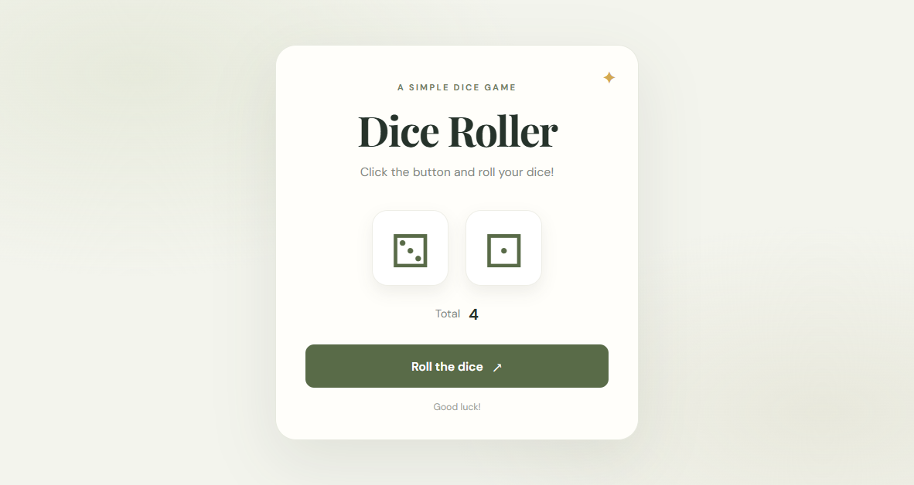

# Dice Roller

A lightweight, responsive dice-rolling app built with React and Vite. Roll two dice, watch the roll animation, and see the combined result.

## Preview



## Features

- Roll two six-sided dice and display their total.
- Animated rolling state with the button disabled while the dice are in motion.
- Responsive layout with reduced-motion support.

## Built with

- [React](https://react.dev/)
- [Vite](https://vite.dev/)
- CSS

## Getting started

### Requirements

- Node.js (LTS recommended)
- npm

### Run locally

```bash
npm install
npm run dev
```

Open the local URL shown in the terminal.

## Available scripts

| Command | Description |
| --- | --- |
| `npm run dev` | Start the local development server. |
| `npm run build` | Create an optimized production build in `dist/`. |
| `npm run preview` | Preview the production build locally. |

## Project structure

```text
.
├── docs/
│   └── images/
│       └── dice-roller-screenshot.png
├── src/
│   ├── modules/
│   │   └── DiceRoller.jsx
│   ├── App.jsx
│   ├── index.css
│   └── main.jsx
├── index.html
├── package-lock.json
├── package.json
└── vite.config.js
```
